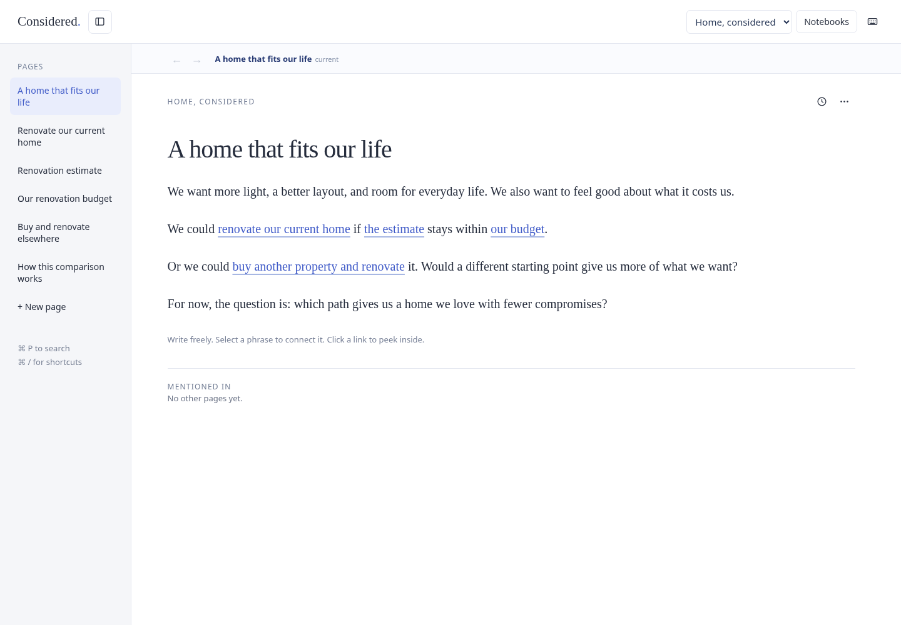
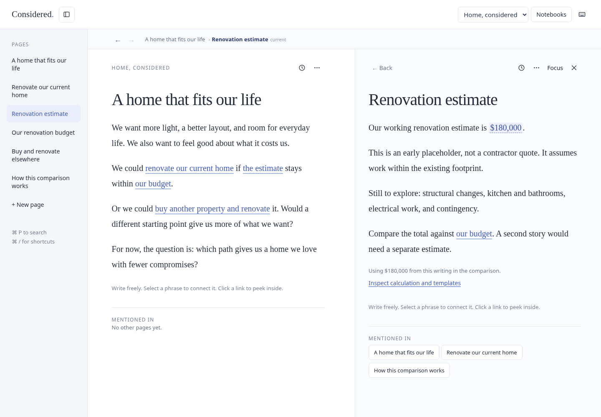

I made a small writing prototype for thinking through a home decision. The starting point is a few paragraphs: renovate the current home, or buy somewhere else and renovate there? Phrases in that writing link to the notes behind the decision.

## Follow a thought without losing your place

Opening “the estimate” brings its source note alongside the main page. The original thought stays visible, and the linked note shows where else it is mentioned. The decision and its supporting details can sit next to each other.

The prototype also lets numbers in the writing act as editable inputs, with the comparison's calculation and wording on their own page. The amounts are illustrative placeholders.

[Open the prototype](https://home-thoughts-james.fine-brush-9025.chatgpt.site/) to explore it if you have access, or open the [notebook screenshot](./overview.png) and [linked-page screenshot](./linked-page.png) on their own.

*Screenshots captured from a local rendering of the prototype's saved source on November 7, 2026, using its illustrative starting notebook.*
