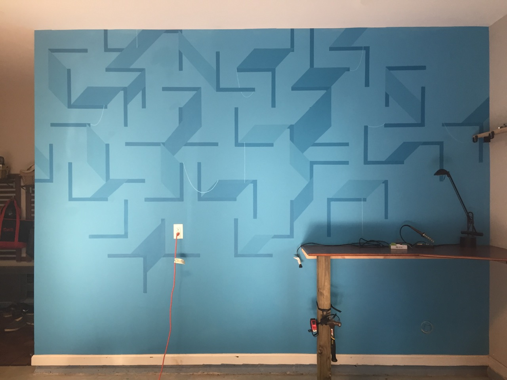

A bit ago I got to paint a mural in my friend's garage. I loved going from a very simple sketch to realizing this simple, Escher-esk mural in about a week.

<figure class="lab-attachment">
  
</figure>
