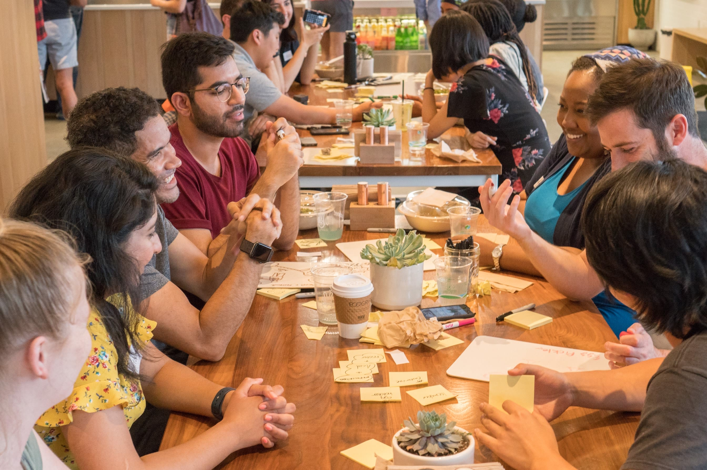
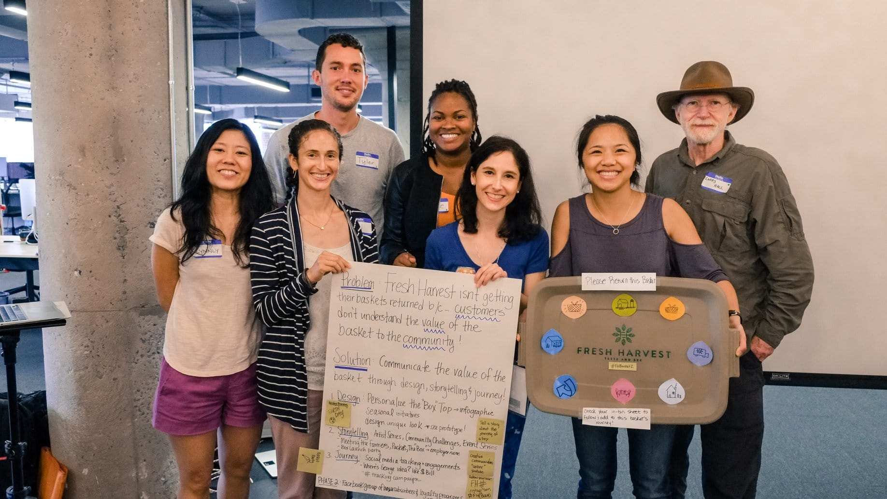

As a volunteer coordinator for the Atlanta Chapter of [OpenIDEO](https://www.openideo.com/), I enjoyed collaborating to build a community centered design process, that is linked with a global online community.

<figure class="lab-attachment">
  
</figure>

<figure class="lab-attachment">
  
</figure>
