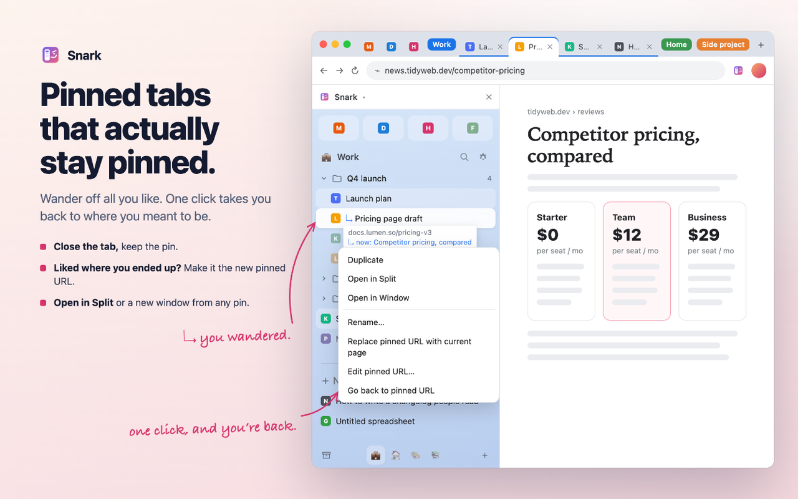
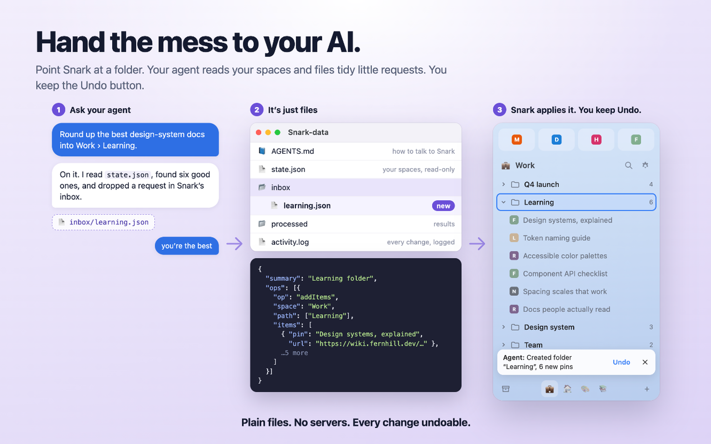

<figure class="lab-attachment">
  <video controls muted loop playsinline data-play-in-view preload="none" width="1920" height="1080" poster="./video-poster.jpg" aria-label="Snark product demo: switching spaces and finding saved tabs with search">
    <source src="./snark-demo.mp4" type="video/mp4">
    <a href="./snark-demo.mp4">Watch the Snark product demo</a>
  </video>
  <figcaption>A short tour captured in Chrome using the Snark development profile and demo pins. Switch spaces, keep saved pages close, and search across them. </figcaption>
</figure>

I only wanted the parts of Arc I actually cared about, the simple things it got right and reason I would eager most people stayed: space, its synthesis of tabs into bookmarks, and other minor niceties. They could take Arc out of our cold dead heands, but can't we still keep those things without committing to an AI-browser?

[Get Snark on the Chrome Web Store](https://chromewebstore.google.com/detail/snark/bffjpilpobpmcgfnbneibbomaecbmjoi) · [Fork it on GitHub](https://github.com/03stories/snark)

## A place for the tabs I mean to keep

Each space is a real Chrome tab group, with its own icon and gradient. I can switch between work, home, and reading; nest folders inside them; and separate saved pages from today's open tabs. Pins remember their original URL even when I browse away. Close the tab, and the pin stays there for next time.

Search brings pins, folders, and spaces together, with their location visible in the results. The extension works locally, without an account or backend. The [privacy policy](https://github.com/03stories/snark/blob/main/PRIVACY.md) explains storage and the optional connections.

## A week of evenings with Claude

I worked with Claude in Cowork. I was the product owner, designer, and daily user. Claude wrote the code, tests, and release materials. My time went into deciding what was worth keeping from Arc, how the interactions should feel, and whether the result actually worked in my browser.

The loop was small: describe a change, sometimes mark up a screenshot, let Claude implement it, reload in Chrome, and react. A screenshot of something that looked wrong was often enough to start the next pass. Claude kept the commits, changelog, and documentation moving alongside the product.

Search is a good example. We first put it in the sidebar. I wanted it centered over the page, then asked why we couldn't use ⌘K for both entry points. Those became three rounds of the same interaction, shipped the same day.

## Letting an agent help organize

One of my questions was whether Claude could read the extension's data. That became an optional local agent folder: Snark writes its state there, and an agent can leave structured commands for it to apply. We designed undo to preserve my own subsequent edits.

Claude used that connection to migrate my Arc export and to research and file pins for me. It made the browser itself part of the workflow, beyond the code we were writing.

## Shipping was part of the experiment

The store images use the extension's actual UI with made-up demo data. Claude rendered that UI, composed the screenshots, and captured them in Chrome. It also prepared the package, listing copy, privacy policy, and permission explanations. I handled the developer account and final submission.

I shipped it to the Chrome Web Store with 55 automated tests and now run it in two real profiles. Daily use surfaced things a polished screenshot couldn't, including a folder-move data-loss bug and reconnect prompts. Staying close to the working product made those issues visible.

What I want to remember is how much of this work was still design: choosing the problem, making small calls, trying the result, and changing my mind. Claude handled the engineering and a lot of the housekeeping. I stayed in the designer's seat, with a working extension to respond to.
