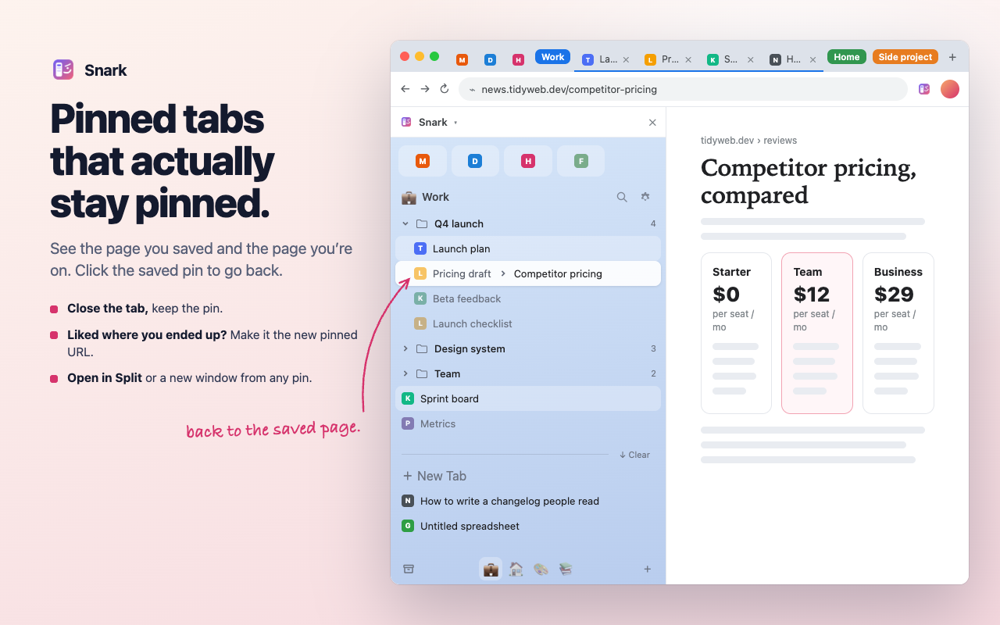
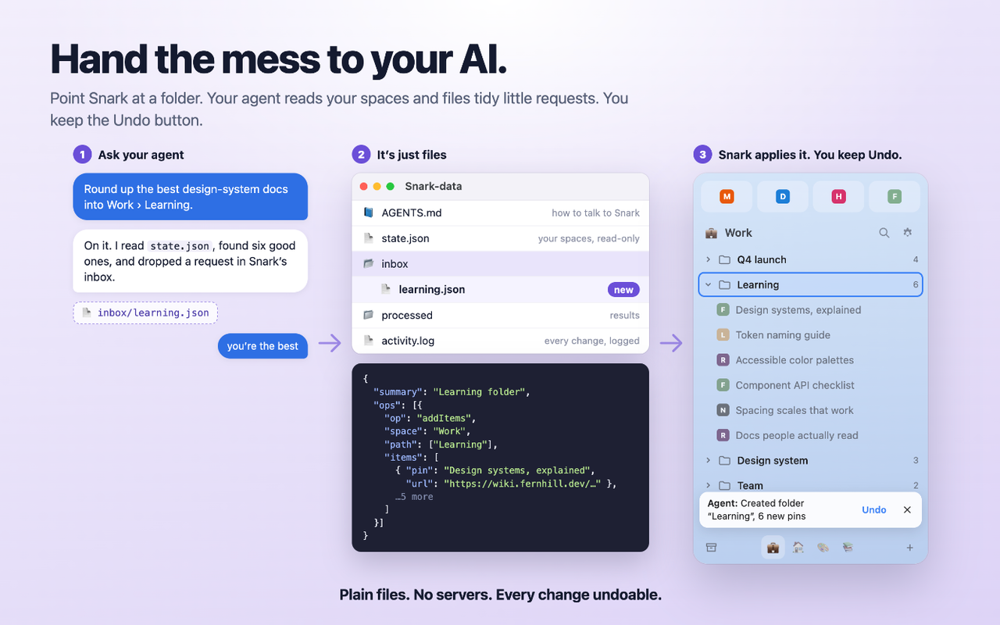

<figure class="lab-attachment">
  <video controls muted loop playsinline data-play-in-view preload="none" width="1920" height="1080" poster="./video-poster.jpg" aria-label="Snark product demo: switching spaces, returning to a saved pin, and finding tabs with search">
    <source src="./snark-demo.mp4" type="video/mp4">
    <a href="./snark-demo.mp4">Watch the Snark product demo</a>
  </video>
  <figcaption>Codex generated this demo video. Pretty good for a first pass, and it works for now. Note to self: record my own when I have a little more time.</figcaption>
</figure>

I wanted to keep the parts of Arc I used every day. Spaces, pins that were bookmarks and tabs at the same time, and little things like copying the current URL with a shortcut. I spent a week of evenings with Claude putting those things into a Chrome extension.

[Get Snark on the Chrome Web Store](https://chromewebstore.google.com/detail/snark/bffjpilpobpmcgfnbneibbomaecbmjoi) · [Fork it on GitHub](https://github.com/03stories/snark)

## What I kept from Arc

If you used Arc, you’ll know what to do with the sidebar. You can tuck tabs into folders, duplicate a tab from the right-click menu, or click a pin to get back to the page you originally saved.

In [1.4.3](https://github.com/03stories/snark/releases/tag/v1.4.3), I made it easier to see where I started. When I follow a link from a pinned page, the sidebar shows the saved pin beside the page I’m on. I can click the saved pin to go back.

I kept colors for spaces. When I’m swiping between them, the color is a quick reminder of where I am. You can also pick your own shortcut for copying the URL in settings.

Search brings pins, folders, and spaces together. Snark works locally, without an account or backend. The [privacy policy](https://github.com/03stories/snark/blob/main/PRIVACY.md) explains storage and the optional connections.

## Working on it in my browser

In Cowork, I’d describe a change to Claude or mark up a screenshot. Once Claude made the change, I’d reload the extension in Chrome and try it. That’s where I made most of the design decisions. Claude handled the code, tests, and release materials.

## Letting an agent help organize

This started with getting my bookmarks out of Arc and into Snark. Claude translated and cleaned up the exported bookmarks along the way.

That gave me a way to keep working with Claude after the move. Snark can write its state to a folder on my computer, and an agent can leave commands there to update my bookmarks. I can ask for a change and see it show up in the sidebar. Any agent that can work with the local folder can use it.

## Shipping was part of the experiment

The store images use the extension's actual UI with made-up demo data. Claude rendered that UI, composed the screenshots, and captured them in Chrome. It also prepared the package, listing copy, privacy policy, and permission explanations. I handled the developer account and final submission.

I shipped it with 55 automated tests and now use it in two real profiles. Using it every day turned up things I could work on, including a bug that could lose data when moving a folder and reconnect prompts.

A product I loved was going away. A week of evenings with Claude gave me a way to keep using the parts I cared about. That’s the part that still feels a little like magic to me.
