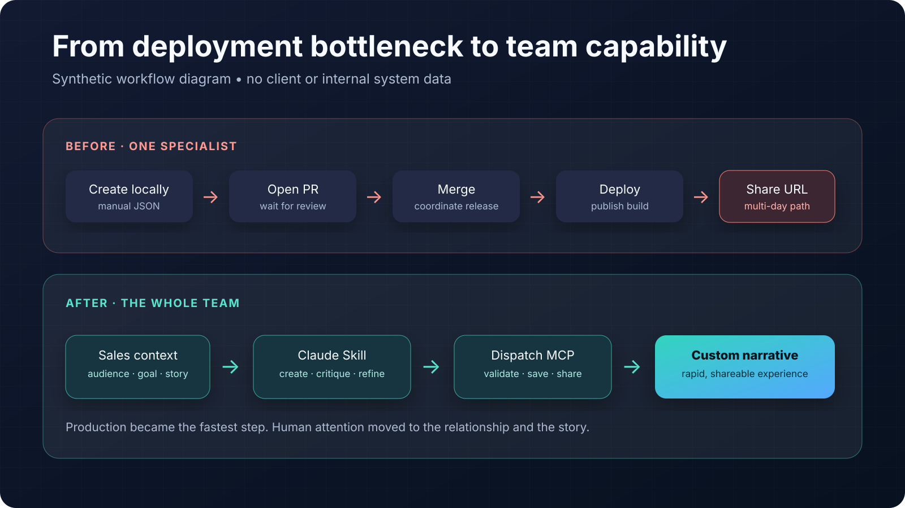
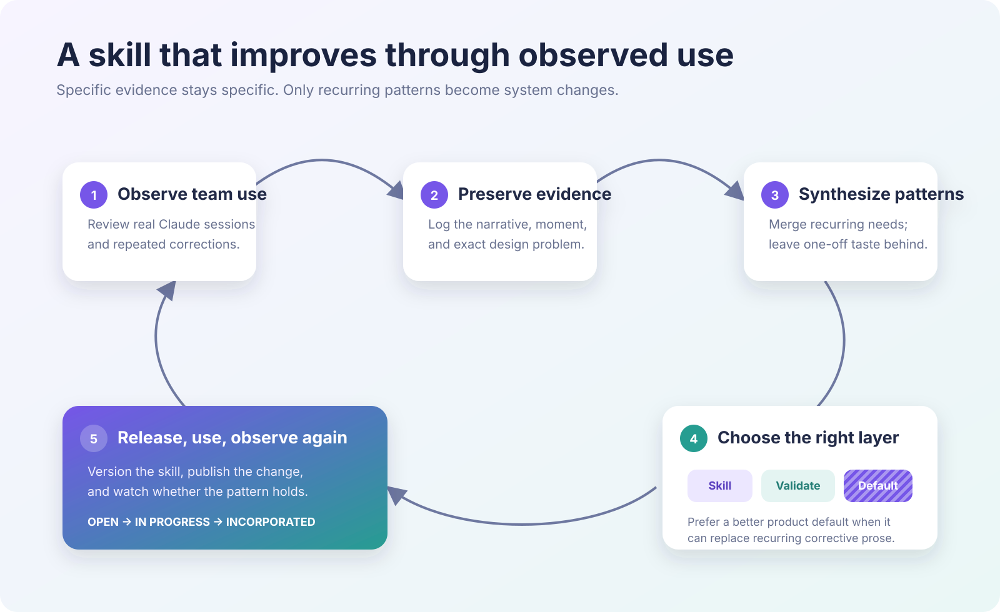
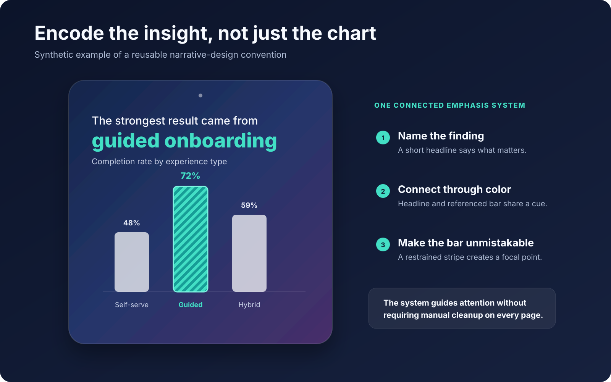

Forward narratives combine data accuracy, story structure, visual pacing, and a growing interaction system. Initially, that expertise—and the ability to publish a narrative—was concentrated in my local workflow.

I designed, built, deployed, and continue to maintain a Claude Skill that makes the narrative system usable across our team. It guides the creative work, connects through MCP to our hosted narrative platform, and turns a finished narrative into a shareable experience without a code deployment.

Our CTO leads the hosted platform, Dispatch. I collaborated closely with him on its MCP interface and the boundary between the platform and my skill. Other teammates now use the skill weekly for sales demonstrations and design prototypes.

# The real bottleneck was not generating text

Before the skill, I manually created and edited every narrative locally. To make one accessible at a URL, I had to open a pull request, wait for review and merge, and then wait for deployment. That path could take multiple days.

This constrained sales conversations. Prospects reacted most strongly when they could see a narrative in their own world—shaped around their use case rather than a generic demonstration—but I was the only person who could produce one.

The goal was not simply to let everyone prompt an AI model. It was to make our accumulated narrative-design judgment available to the team while preserving the product’s technical rules, permissions, and quality standards.

# Decision 1: Separate creative judgment from platform authority

The skill and Dispatch have deliberately different responsibilities.

The skill owns discovery, story structure, writing and visual conventions, stable identifiers, and the choice of which persistence action to take. Dispatch owns authentication, permissions, storage, sharing, and authoritative schema validation.

That division matters. The AI can help create and refine the experience, but it cannot bypass the hosted system’s rules. The skill aims to make a narrative good; the MCP guarantees that what gets saved is valid and authorized.

# Decision 2: Make the expertise portable

The skill works in two contexts. Inside the Forward repository, it can use the full development and validation toolchain. As a deployed standalone skill, it carries the schema, examples, design references, and icon rules needed to work without repository access.

When the Dispatch MCP is available, Claude persists the narrative and returns a shareable experience rather than leaving a block of JSON in a conversation. The same product language and quality rules travel with the skill, wherever a teammate starts.

# Decision 3: Make iteration narrow and lower-risk

Early narratives were treated as complete files. That made a small revision unnecessarily broad: changing one page could mean resending the whole experience.

I introduced stable identifiers for sections and groups and aligned the skill with targeted MCP actions. Claude can now update one group or section while leaving the rest untouched. The hosted platform revalidates the complete narrative before saving.

This makes the editing model match the way people actually work: discuss one moment, change that moment, and preserve everything already approved.

# Decision 4: Curate improvement instead of accumulating prompts

After deployment, we reviewed teammates’ Claude sessions and inventoried what people repeatedly corrected or asked the model to do differently. I turned those conversations into a managed improvement process.

Specific observations stay tied to the narrative that revealed them. Recurring lessons are synthesized, deduplicated, and tracked until incorporated. A single person’s preference does not automatically become a rule.

The key decision is where each improvement belongs. Some changes need clearer skill guidance. Some need validation. Others reveal that the product default itself is wrong.

For example, teammates repeatedly had to correct chart widths and colors. Instead of adding more instructions forever, we made charts responsive and improved their defaults. The skill could then become simpler while every future narrative improved.

# Encoding visual judgment as a reusable pattern

One recurring issue was that generated charts showed the data without clearly communicating the insight. The product already supported richer styling, but AI-authored narratives did not consistently use it.

I added a coordinated visual convention: write a succinct headline around the intended insight, connect its emphasis color to the referenced bar, and give that bar a striped treatment. The reader can immediately see which comparison matters.

Other recurring fixes became conventions for selecting appropriate photography and verifying that every icon actually exists in the Font Awesome kit installed in the product. These are small details individually; together, they move quality from repeated cleanup into the system.

# What changed

The skill replaced a multi-day, single-author pull-request and deployment path with rapid, team-wide narrative creation. Teammates use it weekly to build sales demonstrations and design prototypes directly through Claude.

Narrative creation and iteration are now the fastest part of the workflow. The constraint has shifted to the more valuable work: understanding the prospect relationship, deciding what matters to that audience, and shaping the right story.

That is an organizational outcome rather than a precise time-savings metric. The honest comparison is multi-day production before and rapid creation now—not an invented percentage.

# What I learned

Scaling creative judgment takes more than distributing a prompt. The real product is the improvement loop around it: observe use, preserve specific evidence, identify durable patterns, choose the system layer that should own each fix, and remove instructions when better defaults can carry the behavior.

The skill’s value is not that it eliminates thinking. It moves human attention away from deployment mechanics and toward the sales context, product judgment, and narrative choices where it matters most.
