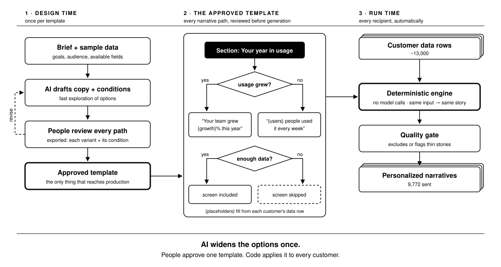

A customer success manager can spend hours pulling together a deck that shows one customer what they got out of a product that year. Top accounts might get that kind of attention. For many other customers, the year might end with a quick email or a check-in call. I started [Forward](https://www.insightsrecap.com/) to help teams give more customers a story about their own results, something they could open on their phone and share with a colleague.

I took Forward from an idea inside Juice Analytics to a working first version and pitched it to our first client. That proposal became a paid pilot and our first production release. I led product direction and built the frontend, [narrative AI skill](/projects/forward-narrative-skill), and generation pipeline. Senior engineers built the supporting backend services and owned frontend testing. I also led the go-to-market work and built the site below.

<figure class="slice-film">
  <video controls muted loop playsinline data-play-in-view preload="none" width="1920" height="1394" poster="./forward-marketing-site-poster.jpg" aria-label="The Forward marketing website" aria-describedby="forward-marketing-caption">
    <source src="./forward-marketing-site.mp4" type="video/mp4">
    <a href="./forward-marketing-site.mp4">Download the Forward marketing website recording</a>.
  </video>
  <figcaption id="forward-marketing-caption" class="portfolio-figure-label">The Forward marketing website · 25 sec · Silent video.</figcaption>
  

    
Read the video description

    
The homepage headline types out “Your customers deserve their own Campaign in Review,” beside a phone playing a live example narrative for a sample company. Scrolling reaches a before-and-after section contrasting a dense annual PDF report with the same results told as a narrative.

  

</figure>

# What a customer receives

In the example below, an early-education team can see which teachers stood out and download badges for its literacy and math outcomes. That was the kind of story we wanted customer-success teams to be able to send without assembling a deck for each account.

<figure class="slice-film">
  <video controls muted playsinline data-play-in-view preload="none" width="1920" height="1224" poster="./forward-narrative-walkthrough-poster.jpg" aria-label="A Forward narrative from a recipient's point of view" aria-describedby="forward-walkthrough-caption">
    <source src="./forward-narrative-walkthrough.mp4" type="video/mp4">
    <a href="./forward-narrative-walkthrough.mp4">Download the narrative walkthrough recording</a>.
  </video>
  <figcaption id="forward-walkthrough-caption" class="portfolio-figure-label">A recipient’s narrative on desktop · 1 min 16 sec · Silent video. Anonymized sample data.</figcaption>
  

    
Read the video description

    
A year-in-review narrative for a sample early-education organization opens with an animated “What. A. Year!” title card. The recipient moves through sections with full-bleed photography: a Documentation section that names standout teachers, then Outcomes, where Literacy and Mathematics appear as shareable, downloadable badges.

  

</figure>

# How a team runs a campaign

We built Forward so teams could repeat the process for different audiences and reporting periods. Each team has its own workspace, with separate roles for people who run campaigns and people who write narratives. A team can upload a batch from the pipeline, create a one-off story, or let an assistant like Claude write directly in the workspace through MCP.

Teams send each recipient a link, which can be open or tied to that recipient. I set the initial direction for how private links work: the link is claimed the first time it’s opened, and the recipient can open it on another device by confirming access to their email. The team that sent the link can see sessions, completions, and responses to questions inside the story.

# Send people straight to their story

An early client needed different parts of its organization to see different versions of a narrative based on their permissions. We could have added a picker so people could filter and switch between the versions they were allowed to see.

I wanted the experience to feel like a small celebration. Giving people a picker would mean asking them to do some of the work we were trying to do for them. It would also change how we served each story, which was generated ahead of time and needed very little data after that.

We used the campaign emails to give people the link for their part of the organization. People could open their link and start reading right away. That gave us a rule for future campaigns: decide who gets each story before it goes out.

# Review the story before generating thousands of versions

AI helped us try out story ideas and work through which parts of a narrative should appear for different customers. I wanted us to be able to review what the system could say before we ran a campaign. A prompt on its own couldn’t give us that.

We reviewed the writing and overall experience, then exported the template for review so people could see every path through the story and the data conditions that would select it. Once approved, the template ran against each customer’s data. The production pipeline made zero model calls.

# Checking a production run

The first campaign processed about 13,000 narratives. Each template had rules for flagging or excluding stories that didn’t have enough to say. Of those narratives, 9,772 passed, and we handed them to the client to send.

The same approved template and customer data always produce the same story, so we can test for the output we expect. The player, pipeline, and Python backend all check the format against one schema defined in TypeScript. Before release, we strip the template rules and authoring notes from the stories.

The recording below shows how we spot-check a run, including opening a flagged story and seeing which parts of the template it used.

<figure class="slice-film">
  <video controls muted playsinline data-play-in-view preload="none" width="1920" height="1224" poster="./forward-devnav-run-qa-poster.jpg" aria-label="Spot-checking a generated run in Forward's review tool" aria-describedby="forward-devnav-caption">
    <source src="./forward-devnav-run-qa.mp4" type="video/mp4">
    <a href="./forward-devnav-run-qa.mp4">Download the run review recording</a>.
  </video>
  <figcaption id="forward-devnav-caption" class="portfolio-figure-label">Spot-checking a generated run · 45 sec · Silent video. Any narrative in a run, including flagged ones, opens in desktop, tablet, or phone view. Anonymized sample data.</figcaption>
  

    
Read the video description

    
A review panel lists the 85 narratives in a sample run, with each customer’s status, section count, and page count. Filters narrow the list by quality flags such as “more teachers than students.” Selecting a flagged narrative shows which template groups it used, and switching to phone view previews the same story in a phone frame.

  

</figure>

# How customers responded

We could see what happened from the moment someone opened a link. People reached the end of 864 of the 1,448 narratives they opened (60%). In 715 of those completed narratives (83%), someone answered yes when asked if they’d like to get another one the following year.

Some people asked to receive these stories more often. Others told us they’d shared theirs with colleagues or planned to.

# What I would improve now

Next time, I’d spend more design time on how the team sees what changed between versions of a template. It’s getting easier to generate content. I’d like it to be just as easy to tell which wording changed, which customers would see it, and what someone needs to review again.
