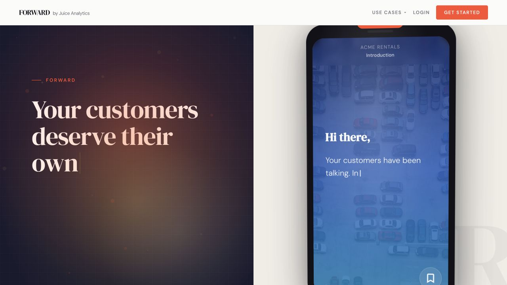

[Forward](https://www.insightsrecap.com/) helps customer-success teams turn product data into personalized, mobile-first narratives for every customer—not only the accounts with a dedicated CSM and a custom deck.

I originated the product inside Juice Analytics, took it from concept through MVP deployment, and pitched the first client proposal. That proposal became a paid pilot and the first production release. I led product direction and built the frontend, narrative AI skill, and generation pipeline. Senior engineers built the supporting backend services and owned frontend testing.

# The customer-success gap

Before Forward, our clients struggled to communicate their product's positive impact at scale. CSMs could give top accounts individual attention, but medium and long-tail customers were often underserved. Even among accounts receiving a year-end touchpoint, the quality varied from a basic email or check-in call to a manually assembled deck.

That manual work could take hours. More importantly, customers were left to infer the value they received. The opportunity was not simply to automate a report; it was to make ROI feel personal, clear, and worth sharing without multiplying the workload of the customer-success team.

# Decision 1: Keep exploration out of the experience

The first client needed permission-aware targeting for different organizational units. One plausible solution was a query-backed picker inside the product, allowing users to filter and switch among versions of a narrative.

I decided against it.

Forward was intended to be lightweight, celebratory, and easy to finish—not another data-exploration interface. Adding filtering would shift the experience from receiving a coherent story to operating a reporting tool. It would also weaken a useful technical constraint: each narrative was pre-generated, self-contained, and minimally dependent on data after generation.

We moved audience targeting upstream to the sent emails. Recipients opened the right narrative directly, while the product preserved a focused beginning-to-end experience. More interaction could come later, but it would have to strengthen the narrative rather than turn it into a dashboard.

# Decision 2: Use AI to explore; use an approved system to scale

Personalizing thousands of narratives introduced a more consequential choice: allow an AI model to generate copy freely at production scale, or build a system whose output could be understood and approved before generation.

I rejected unreviewed generative text at scale. Prompt guardrails alone did not provide the oversight we needed.

Instead, AI accelerated narrative exploration and helped define data-based conditions. Humans accepted the stylistic direction and overall experience, while deterministic template conditions were evaluated through a managed process before generation. A structured export enumerated every template and condition for review.

This separated creative exploration from production behavior. Once the narrative system was approved, the pipeline could generate thousands of personalized stories without requiring a person to review every individual output.

> **Process visualization placeholder.** An anonymized diagram will explain how template and condition paths branch before generation. It will be an explanatory model rather than the production review interface.

# What shipped

The first production run processed roughly 13,000 narratives. Defined quality gates determined whether each story had enough meaningful material to send; 9,772 passed those gates and were delivered.

The release included the recipient-facing experience, the narrative AI skill, and the pipeline for generating stories at scale. The broader team supplied the backend services and production test coverage.

# Evidence that the story connected

Among 1,448 opened narratives, 864 reached the end—a 60% completion rate. Of those 864 completed narratives, 715 included a “Yes” response to receiving the experience again the following year, or 83%.

The qualitative response matched the behavior. Users asked to receive narratives like this more often and reported that they had shared, or planned to share, them with colleagues.

Those results do not prove every downstream retention outcome. They do show that a scaled customer-success touchpoint could hold attention, create sharing intent, and leave most finishers wanting another one.

# What I would improve now

I would invest earlier in observability for AI-assisted content systems. Generation is no longer the hardest part. The limiting factor is understanding how content, conditions, and behavior change over time—and giving a team enough visibility to review those changes with confidence.

Forward reinforced a product principle I continue to use: AI can widen the space of possibilities, but trust at scale comes from making the final system legible, governable, and intentionally constrained.
