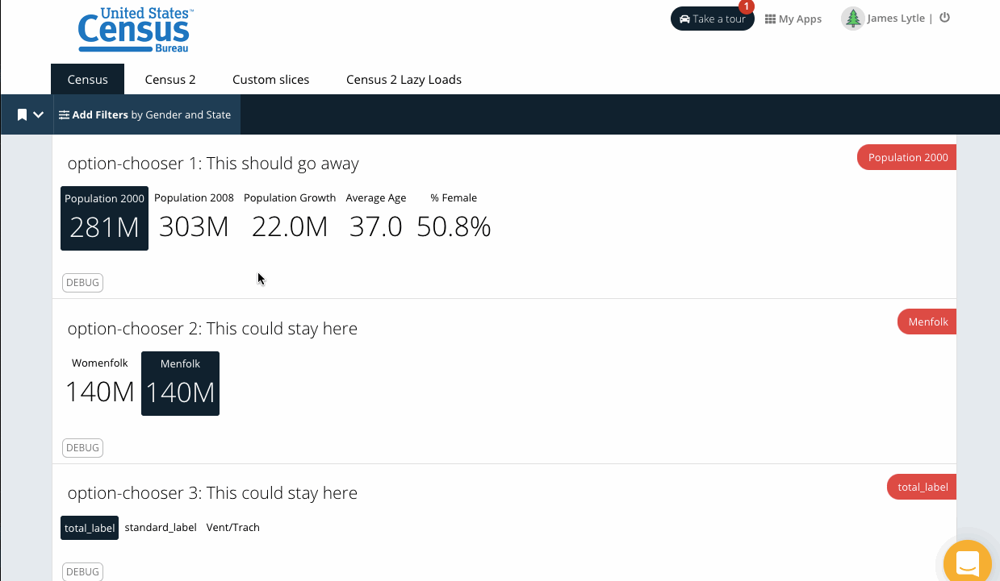
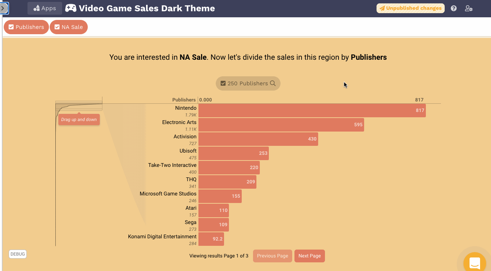
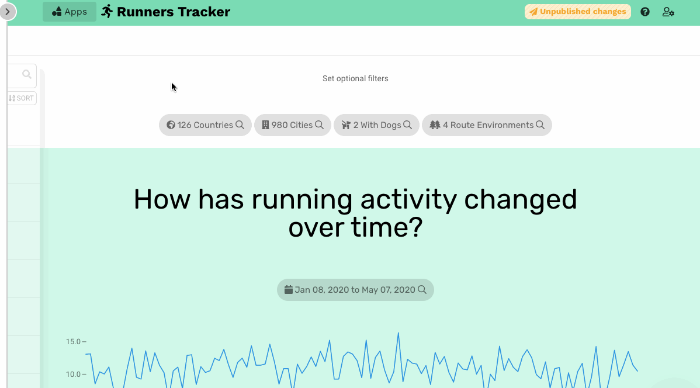
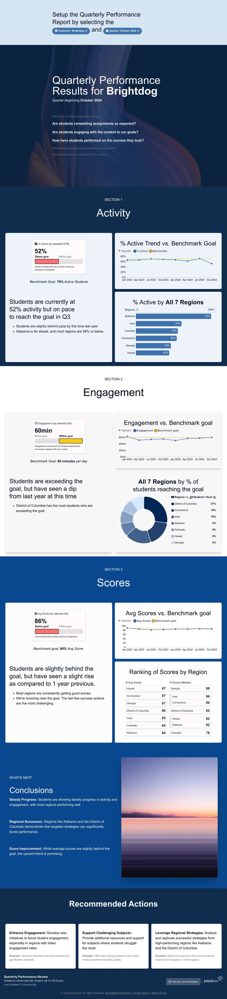
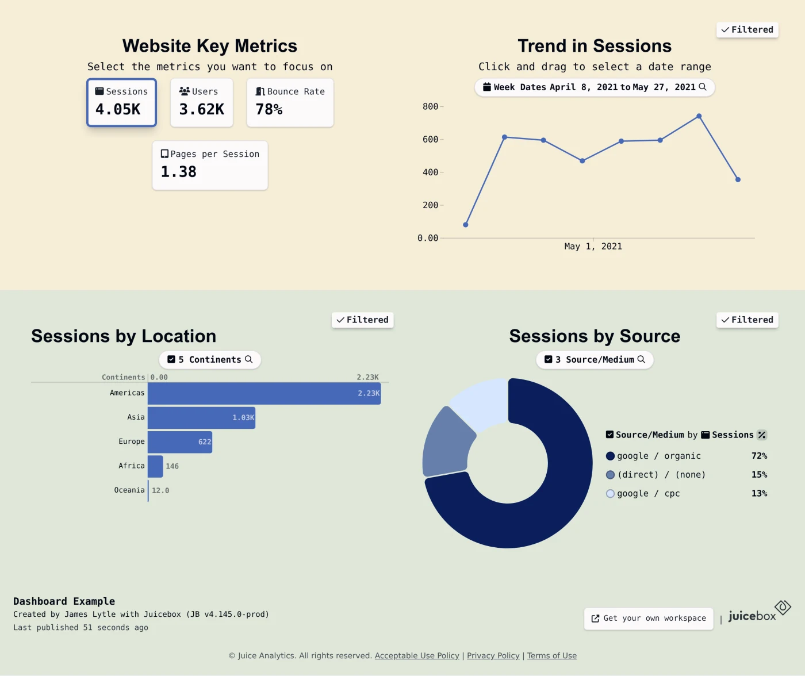
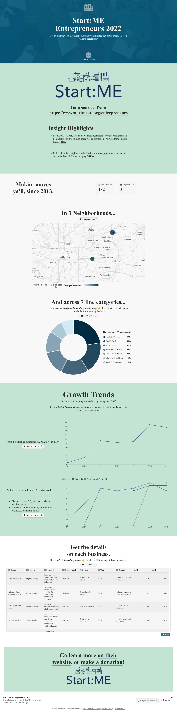
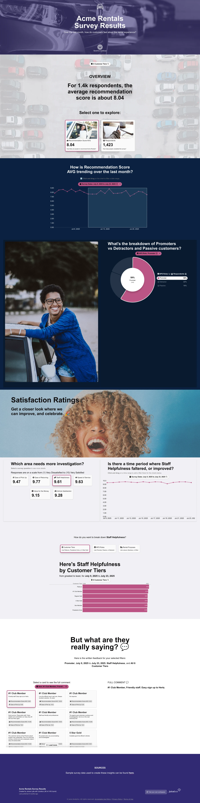

Before we built [Juicebox](https://www.juiceanalytics.com/), our team made roughly 30–40 custom data apps. We kept seeing the same needs. People who didn’t work with data every day needed to know what a report was telling them, where to go next, and how to use the charts along the way.

I led interaction and interface design as we turned those patterns into reusable building blocks, then designed the Editor customers use to make their own reports. The sample below shows what a reader sees: a survey report that combines writing and photography with charts you can explore.

<figure class="slice-film">
  <video controls muted loop playsinline data-play-in-view preload="none" width="1920" height="1198" poster="./juicebox-sample-poster.jpg" aria-label="Juicebox sample customer-reporting experience" aria-describedby="juicebox-sample-caption">
    <source src="./juicebox-sample.mp4" type="video/mp4">
    <a href="./juicebox-sample.mp4">Download the Juicebox sample recording</a>.
  </video>
  <figcaption id="juicebox-sample-caption" class="portfolio-figure-label">A sample customer-reporting experience in Juicebox · 1 min 5 sec · Silent video.</figcaption>
  

    
Read the video description

    
A walkthrough of the Acme Rentals Survey Results report combines photography, narrative text, and interactive charts. The recording shows survey-date selections and customer-response breakdowns, including a pie chart of promoter, detractor, and passive respondents.

  

</figure>

# Learn from the reports we were already building

We organized reports into Stories made from configurable components called Slices. A developer could use the same building blocks across different client reports, and readers could learn how a Slice behaved and carry that knowledge to the next one.

Every option made a Slice more flexible. Add enough options and you’ve built a programming language. We wanted a small set of building blocks that could each do more.

We’d put editing into an earlier product from the start. This time, we had our own developers configure client reports first. That gave us a better sense of which options people needed and which ones made a report harder to build. By the time we could make very different reports in a few weeks, I had two to three years of design and configuration work to look back on. I used that work to refine how Slices were configured before we put those controls in the Editor.

# Give filters a home in Slices

Global Filters were easy to add. The catch was that a reader had to wait for every filter to load before seeing the story. Slices were already doing some of the same work, so we were heading toward two ways of filtering that we’d have to keep in sync.

We could speed up Global Filters, make a dedicated filter Slice, or teach the Slices we already had to do the job. I led that third approach, Slices 2.0. We had to keep existing reports working and give developers a consistent way to set up the new behavior in YAML.

A Slice could now show your selection in a small pill. Click the pill and you could search or sort the full list in a side panel. Developers could use the same `display_slice_as` setting to show a compatible Slice as a visualization, a pill, or both.

That meant we could put filters right where they mattered in a story. Related filters could sit together and update one another’s available choices. A reader could see counts while the full values were still loading, and Slices with nested choices could use the same selection behavior.

Existing reports kept working, and we had one filtering system to build on in new reports.

## What happens when you select a slice of pie?

In the prototype below, hovering over the chart also highlights its legend entry. Select Nashville and “41 Other” and the filter pill has to make clear what you chose. That’s 42 cities behind two labels.

I worked through those details in Figma, along with what happens when the chart gets squeezed into a narrow space, a label runs long, or the author removes a required input. It had to behave predictably in all of those cases.

<figure class="slice-film">
  <video controls muted playsinline data-play-in-view preload="none" width="1920" height="1080" poster="./pie-slice-poster.jpg" aria-label="Pie Slice interaction and system-state prototypes" aria-describedby="slice-film-caption">
    <source src="./pie-slice-interactions.mp4" type="video/mp4">
    <a href="./pie-slice-interactions.mp4">Download the Pie Slice prototype video</a>.
  </video>
  <figcaption id="slice-film-caption" class="portfolio-figure-label">Figma design prototypes · 1 min 21 sec · Silent video. Hover and selection, authoring rules, and layout and formatting states.</figcaption>
  

    
Read the video description

    
The pointer moves between the pie chart and legend to show coordinated hover feedback, then selects Nashville and the grouped 41 Other cities. The combined selection represents 42 cities. The authoring prototype demonstrates required inputs, dimension and measure choices, display modes, and returning to an incomplete configuration when an input is removed. Further examples show a dark background, narrow, intermediate, and wide layouts, minimum and maximum label widths, long names, and large values. Finally, a filter change animates the chart while preserving Nashville's selection context.

  

</figure>

# Keep the shape of the report in view

A small report was easy to scan in the original Editor. You could see the sections, the Slices, and their settings all together. As reports got bigger, those same settings filled up the panel. Finding a different part of the story could mean a lot of scrolling.

I designed the new Editor around a folder tree so authors could see the shape of the report at a glance. I designed the tree, the sliding panels that open when you need more detail, and the controls inside them. I built working prototypes for the frontend engineers, who implemented the production React system. I came back into the code after that to ship some UI and interaction refinements.

The rollout went smoothly and we heard praise from customers. Watch where the settings go in these two recordings. Both show someone adding key metrics to a Sales Dashboard. In the newer Editor, the tree stays in view while a separate panel opens for the settings.

<figure class="slice-film">
  <video controls muted playsinline data-play-in-view preload="none" width="1920" height="1080" poster="./editor-before-2022-poster.jpg" aria-label="Before: Juicebox Editor in 2022" aria-describedby="editor-before-caption">
    <source src="./editor-before-2022.mp4" type="video/mp4">
    <track kind="captions" src="./editor-before-2022.en.vtt" srclang="en" label="English">
    <a href="./editor-before-2022.mp4">Download the old Editor recording</a>.
  </video>
  <figcaption id="editor-before-caption" class="portfolio-figure-label">Before · 2022 · 44 sec. Add and configure key metrics through controls stacked inline beside the report. Excerpt from <a href="https://www.youtube.com/watch?v=ztXWsWjPCgU&t=222s">Juice Analytics’ overview demo</a>, 3:42–4:26. Audio with English captions.</figcaption>
  

    
Read the video description

    
The Sales Dashboard contains a pie chart and a trend chart. The author adds a Chooser Slice, titles it Key Metrics, increases the heading size, and selects Sales and Profit. The two totals appear in the report. Section content and detailed configuration share the same scrolling editor panel.

  

</figure>

<figure class="slice-film">
  <video controls muted playsinline data-play-in-view preload="none" width="1920" height="1306" poster="./editor-after-2026-poster.jpg" aria-label="After: Juicebox Editor in 2026" aria-describedby="editor-after-caption">
    <source src="./editor-after-2026.mp4" type="video/mp4">
    <a href="./editor-after-2026.mp4">Download the redesigned Editor recording</a>.
  </video>
  <figcaption id="editor-after-caption" class="portfolio-figure-label">After · 2026 · 1 min · Silent video. Navigate the report’s folder tree and open configuration panels as needed while adding and connecting key metrics.</figcaption>
  

    
Read the video description

    
The Sales Dashboard’s sections and Slices appear in a compact tree beside the report. The author opens configuration for individual Slices, adds a Key Metrics chooser with Sales and Profit, and connects the trend chart to that chooser. Additional choices open in an adjacent panel, separating report structure from detailed configuration.

  

</figure>

# What shipped

What started as a way for our developers to assemble client reports grew into a tool customers could use to connect data, design a report, and publish it themselves. Below are a few examples of what that range looks like, from a compact dashboard to a longer story about neighborhood businesses.

  

    <figure>
      
      <figcaption class="portfolio-figure-label">Quarterly performance review Benchmarks, progress, and recommended actions.</figcaption>
    </figure>
  

  

    <figure>
      
      <figcaption class="portfolio-figure-label">Website dashboard <a href="https://james.myjuicebox.io/a/dashboard_example_3/?h=Ep_ZyFNUAgnRpuI3EkczHXg4Fl4">Explore the live dashboard</a></figcaption>
    </figure>
    <figure>
      
      <figcaption class="portfolio-figure-label">Start:ME Entrepreneurs A community story told through maps, trends, and business details.</figcaption>
    </figure>
  

  

    <figure>
      
      <figcaption class="portfolio-figure-label">Customer survey report <a href="https://james.myjuicebox.io/a/survey_example_3/">Explore the live survey report</a></figcaption>
    </figure>
  

You can still [sign in to Juicebox](https://juiceboxdata.com/), and the [workspace documentation](https://docs.myjuicebox.io/getting-started/new-workspace) shows how authors get started.

# What I would improve now

I’d add a floating Editor. The tree makes a large report easier to get around, but the editing panel still takes up some of the canvas. For a complex layout, I’d like to be able to move that panel out of the way and keep editing while I see the report at full width.
