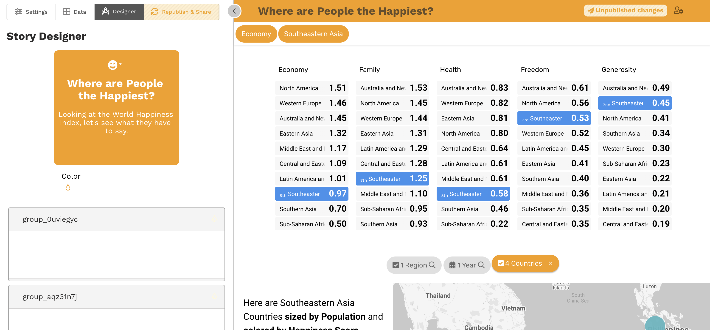
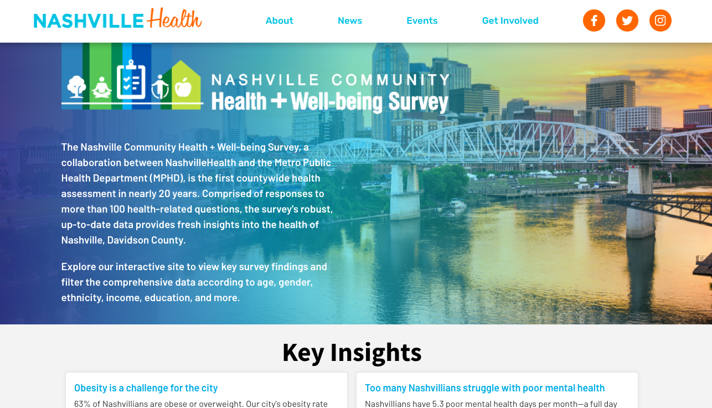
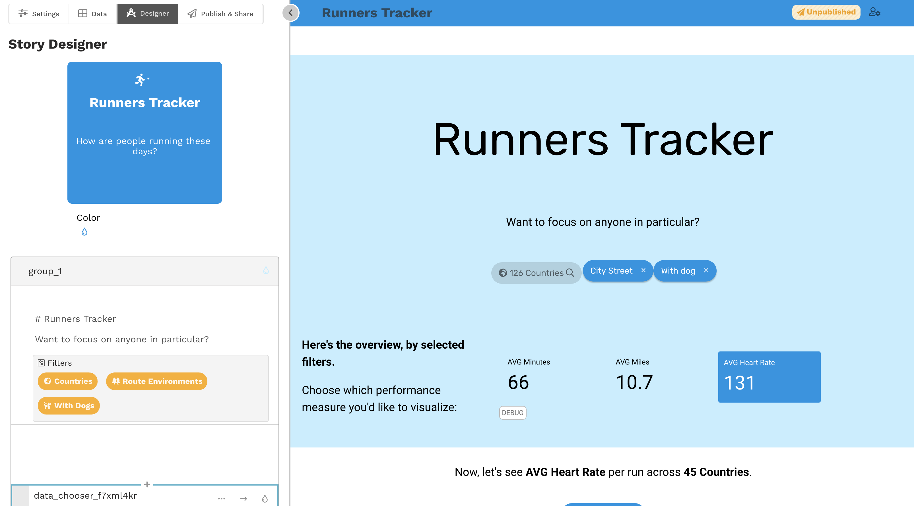
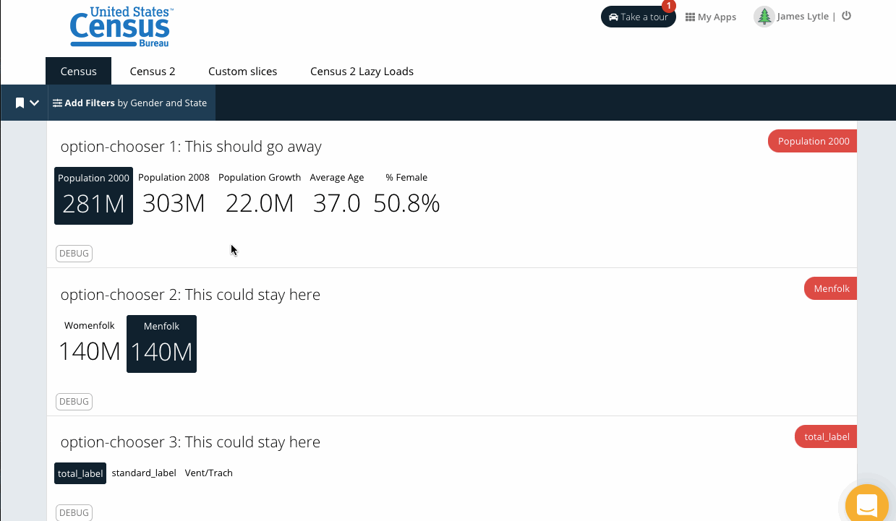
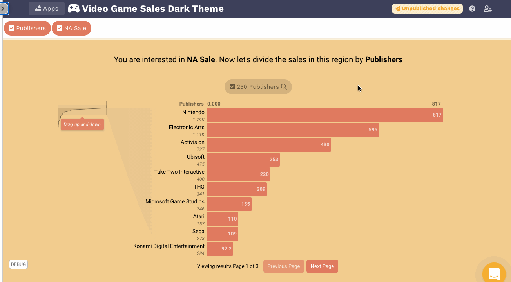
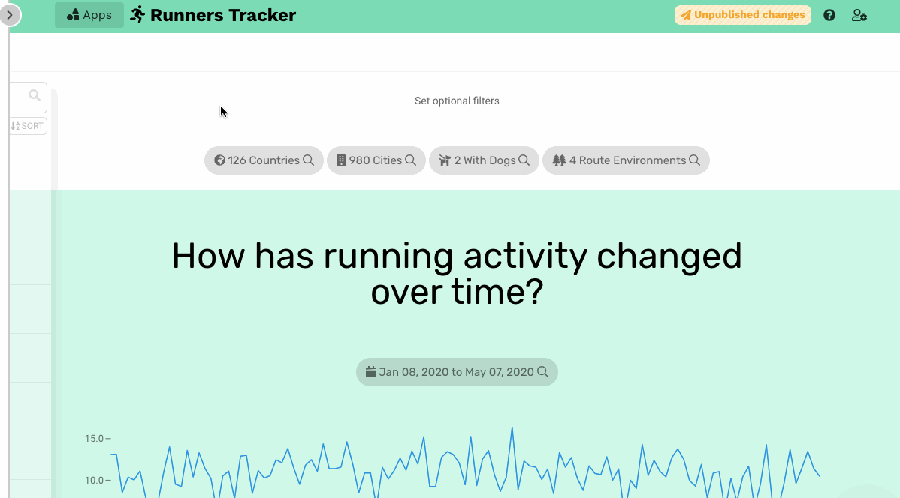
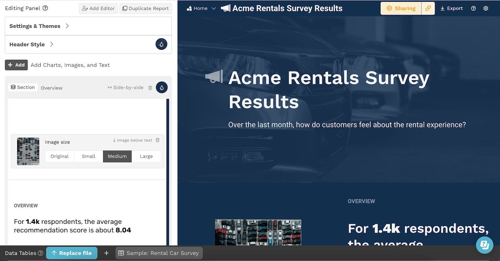
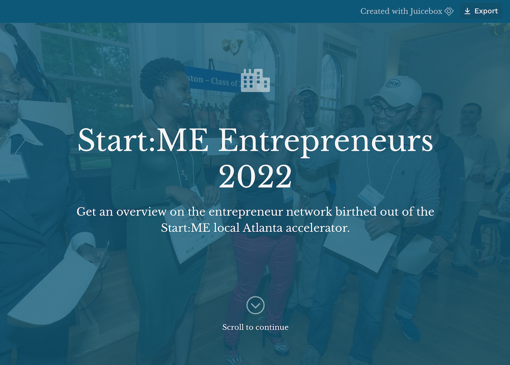

[Juicebox](https://www.juiceanalytics.com/juicebox-for-databricks) is an active, configurable customer-reporting platform for turning data into guided, interactive stories. I led interaction and interface design across its evolution, from the building-block system used by internal app developers to the self-service Editor customers use to author reports.

My work sat between product architecture, interaction design, and implementation. I designed reusable product systems, translated recurring client patterns into configuration models, built working definition prototypes, and implemented targeted frontend refinements. Engineering partners owned the underlying platform and production React system.

# From custom applications to a product system

Before Juicebox, our team had designed and developed roughly 30–40 custom data applications. Repeated patterns were becoming visible: non-analytical audiences needed purposeful messaging, a guided narrative flow, and consistent visual building blocks—not a blank dashboard canvas.

Juicebox turned those patterns into a platform. A report could contain multiple Stories, each assembled from configurable components called Slices. Shared interaction behavior made the experience coherent for end users, while common configuration gave app developers a reusable system for creating different customer reports.

The product tension was constant: every new option increased flexibility, but too much flexibility would turn the platform into a development language. The goal was a smaller family of richer building blocks that made good reporting decisions easier.

# Decision 1: Learn through real client work before opening self-service

Our earlier product exposed editing from the beginning. For Juicebox, we chose to mature the platform first while internal developers configured client applications.

Building a self-service Editor too early would have forced us to formalize abstractions before we understood which patterns were genuinely reusable. Working through varied client reports let us learn where customization was valuable, where consistency mattered, and which options created unnecessary complexity.

Once the team could design and develop diverse reports within weeks, the repeated patterns were stable enough to expose through a customer-facing authoring experience. I analyzed two to three years of configuration and design behavior, then iterated on the Slice configuration model before it became part of the Editor.

# Decision 2: Unify filtering through Slices 2.0

As the platform grew, two filtering systems had begun to overlap. Global Filters were easy to add, but every filter's data had to load before the story itself appeared. They also duplicated capabilities that increasingly belonged in Slices, creating two systems that would drift in behavior and cost more to maintain.

We could optimize Global Filters, create a special filters-only Slice, or unify filtering within the common Slice model. I specifically drove the third direction.

The difficult part was preserving existing client behavior while improving performance, end-user coherence, and YAML configuration for app developers. The design centered on persistent Slice pills: a compact selection state that could also open the Slice's data in a searchable, sortable side panel. A shared `display_slice_as` option let any compatible Slice appear as a visualization, a pill, or both.

This unlocked more than a replacement for Global Filters. Slice groups could place related filters together, add context, share layout behavior, and support crossfiltering. Lazy loading returned useful counts before full data values. Hierarchical Slices gained a consistent selection experience, and reports could place filters inline rather than isolate them in a header.

The result was one primary filtering architecture the team could continue improving. Existing apps retained backward compatibility, while new apps could move to the richer Slice model.

# Decision 3: Redesign the Editor for platform-scale complexity

The original Editor made a smaller report easy to scan because configuration for its Slices and sections was visible together. As the platform evolved, that strength became a liability. Complex reports produced a cluttered interface, obscured the high-level structure, and forced authors to scroll repeatedly between distant parts of a story.

The choice was to preserve all-at-once visibility or introduce hierarchy and reveal detail only when needed.

I designed the complete new experience: a folder-tree model for understanding and navigating report structure, a list experience optimized for speed, a sliding-panel system for progressively revealing detailed configuration, and the configuration components themselves.

I implemented working definition prototypes for handoff to frontend engineers, who built the production React system. After that implementation, I returned to the code to ship a series of UI and UX refinements.

The redesign rolled out smoothly and received customer praise. We do not have hard efficiency metrics, so the strongest evidence will be a matched before-and-after comparison of the old scroll-heavy experience and the new hierarchical model.

> **Before-and-after visual forthcoming.** This comparison will show the same or a comparable report in the old and new Editors, highlighting structural navigation, full-story orientation, and progressively disclosed configuration.

# What shipped

Across its evolution, Juicebox supported a wide variety of private customer reports and public examples in healthcare, entrepreneurship, survey analysis, politics, and personal data. The platform expanded from internal developer configuration into a self-service authoring experience spanning data sources, report design, templates, publishing, sharing, trials, and workspaces.

Slices 2.0 supplied a more coherent filtering and layout foundation. The latest Editor redesign supplied an information architecture that could keep pace as reports became more complex. Juice Analytics continues to identify Juicebox as its technology platform, with active [product sign-in](https://juiceboxdata.com/) and [workspace documentation](https://docs.myjuicebox.io/getting-started/new-workspace).

# What I would improve now

I would add a floating Editor mode that lets the report remain full width while editing. The folder tree and sliding panels improved navigation and progressive disclosure, but some complex layouts are best judged at their real canvas width. A floating mode would preserve editing access without compromising the design context an author needs.

The larger lesson is that authoring tools have two products inside them: the experience being created and the system used to create it. A scalable Editor has to keep both understandable as the platform grows.
